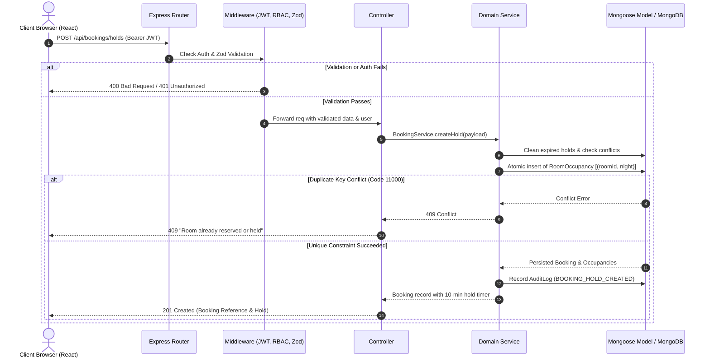

# Architecture Specification — Hotel Booking Management System
**Company:** ALGIONS AI LABS PRIVATE LIMITED  
**Project:** Hotel Booking Management System  
**Pattern:** Modular Monolith Architecture  

---

## 1. High-Level Architectural Pattern

The application implements a **Modular Monolith Architecture** using the **MERN Stack** (MongoDB, Express.js, React.js, Node.js). 

```mermaid
flowchart TD
    subgraph Presentation_Layer["Presentation Layer (React + Vite + Tailwind CSS)"]
        UI_Guest["Guest Portal\n(/, /rooms, /availability, /booking, /payment)"]
        UI_Staff["Staff Desk\n(/staff/dashboard, /staff/bookings, /staff/rooms)"]
        UI_Admin["Admin Control Center\n(/admin/dashboard, /admin/rooms, /admin/reports, /admin/audit-logs)"]
    end

    subgraph API_Gateway["API Gateway & Cross-Cutting Middleware"]
        CORS["CORS & Helmet"]
        RateLimit["Rate Limiting\n(300 req / 15 min)"]
        AuthMiddle["JWT Auth & Server-side RBAC\n(guest, staff, admin)"]
        ZodVal["Zod Schema Validation"]
    end

    subgraph Backend_Modules["Application Service Modules (Express.js)"]
        AuthMod["01. Auth & Identity Module"]
        RoomMod["02. Room & Rate Management"]
        AvailMod["03. Availability Engine"]
        BookMod["04. Booking & Concurrency Engine"]
        PayMod["05. Payment Simulation Engine"]
        RepMod["06. Analytics & Financial Reporting"]
        AuditMod["07. Audit Logging Module"]
    end

    subgraph Persistence_Layer["Data Persistence Layer (MongoDB)"]
        Col_Users["Users Collection"]
        Col_RoomTypes["RoomTypes Collection"]
        Col_Rooms["Rooms Collection"]
        Col_Occupancies["RoomOccupancies Collection\n(Unique Compound Index: roomId + night)"]
        Col_Bookings["Bookings Collection\n(Unique Index: bookingReference)"]
        Col_Payments["Payments Collection\n(Idempotency Index)"]
        Col_Audit["AuditLogs Collection"]
    end

    Presentation_Layer -->|HTTP / REST (JSON)| API_Gateway
    API_Gateway --> Backend_Modules
    Backend_Modules -->|Mongoose ODM| Persistence_Layer
```

### Why Modular Monolith?
1. **Low Operational Overhead:** Avoids network hops, distributed transaction coordination (2PC / Saga), and multi-service deployment complexities required by microservices.
2. **Atomic Integrity:** Allows atomic validation across rooms, occupancies, and booking entities inside single transactions and MongoDB compound indexes.
3. **Domain Separation:** Code is strictly partitioned by business modules (`routes/` -> `middleware/` -> `controllers/` -> `services/` -> `models/`). Each module owns its validation, business rules, and models.

---

## 2. Request Lifecycle & Layered Responsibilities



---

## 3. Concurrency & Integrity Strategy

Double-booking prevention is enforced mathematically through **three defensive layers**:

1. **Unique Compound Index on `RoomOccupancy`:**
   ```javascript
   roomOccupancySchema.index({ roomId: 1, night: 1 }, { unique: true });
   ```
   For a reservation spanning 3 nights, 3 discrete records are inserted:
   - `(Room 101, 2026-11-12)`
   - `(Room 101, 2026-11-13)`
   - `(Room 101, 2026-11-14)`
   If a parallel request attempts to claim any overlapping night, MongoDB's storage engine enforces the unique index constraint and rejects the second insert with error `11000`.

2. **Temporary 10-Minute Hold Expiration:**
   - When a hold is initiated, `status: 'hold'` and `holdExpiresAt = now + 10 mins` are stamped.
   - Availability searches dynamically treat holds where `holdExpiresAt <= now` as **unblocked**.
   - Before attempting an insert, the service executes a proactive cleanup to release stale expired holds.

3. **Status Machine Transition Invariants:**
   State transitions are strictly verified on the backend:
   ```
   [pending] --(payment success)--> [confirmed]
   [pending] --(hold expires)-----> [expired]
   [pending] --(payment fails)-----> [failed]
   [confirmed] -(staff check-in)---> [checked-in]
   [checked-in] (staff check-out)-> [checked-out]
   [confirmed] -(guest cancel)-----> [cancelled] (triggers automated refund)
   ```
   Any illegal transition (e.g., checking out before checking in, or checking in a cancelled booking) is rejected with HTTP `400 INVALID_STATUS_TRANSITION`.

---

## 4. Security Architecture

1. **Authentication:** Stateless JSON Web Tokens (JWT) signed with HMAC-SHA256 and verified via `authenticate` middleware.
2. **Server-side Authorization (RBAC):**
   - Hiding UI buttons is treated only as a UX convenience.
   - Every protected API route enforces `authorize('admin')` or `authorize('staff', 'admin')`.
   - Guest APIs restrict queries so users can only access their own reservation records.
3. **Input Sanitization & Schema Validation:** Powered by Zod schemas validating request body, query params, and parameters prior to reaching controllers.
4. **Idempotency Keys:** Simulated payment API supports unique idempotency keys (`idempotencyKey`), preventing duplicate charges from accidental double clicks.
5. **Audit Logging:** Every critical state transition (room creation, status changes, holds, confirmations, cancellations, check-in, check-out) is recorded in the `AuditLog` collection with actor ID, IP address, and metadata.
