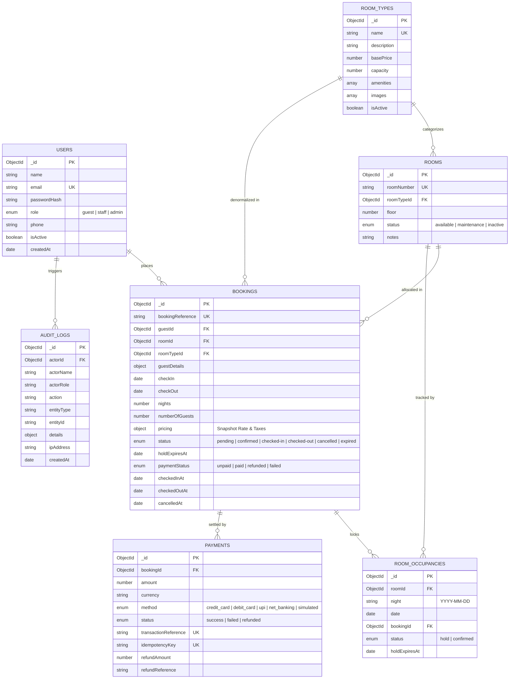

# Database Schema & Data Model Specification
**Database:** MongoDB  
**ODM:** Mongoose  
**Design Pattern:** Normalized References with Snapshot Pricing  

---

## 1. Logical Data Relationship Diagram



---

## 2. Collection Schemas & Detailed Field Specifications

### 2.1. `users` Collection
Stores registered accounts across all roles (Guest, Frontdesk Staff, Administrator).
| Field | Type | Attributes | Description |
|---|---|---|---|
| `_id` | ObjectId | Primary Key | Auto-generated document ID |
| `name` | String | Required, Trim | User legal name |
| `email` | String | Required, Unique, Lowercase | User email address (Indexed) |
| `passwordHash` | String | Required | bcrypt-hashed password (cost factor 10) |
| `role` | String | Enum (`guest`, `staff`, `admin`) | Server-side authorization role |
| `phone` | String | Optional, Trim | Contact telephone number |
| `isActive` | Boolean | Default `true` | Account suspension flag |
| `createdAt` / `updatedAt` | Date | Timestamps | Audit timestamps |

**Indexes:**
- `{ email: 1 }` (Unique)
- `{ role: 1 }`

---

### 2.2. `roomtypes` Collection
Catalog of room categories with pricing, capacity limits, and amenity tags.
| Field | Type | Attributes | Description |
|---|---|---|---|
| `_id` | ObjectId | Primary Key | Document ID |
| `name` | String | Required, Unique | e.g., "Standard Room", "Deluxe Suite" |
| `description` | String | Required | Detailed amenity and design description |
| `basePrice` | Number | Required, Min 0 | Default nightly rate in INR |
| `capacity` | Number | Required, 1 - 10 | Maximum guest occupancy |
| `amenities` | Array of Strings | Default list | Features (Wi-Fi, AC, Smart TV, Mini Bar) |
| `images` | Array of Strings | Default empty | High-resolution photography URLs |
| `isActive` | Boolean | Default `true` | Visibility flag |

---

### 2.3. `rooms` Collection
Physical hotel room units assigned to categories and floor levels.
| Field | Type | Attributes | Description |
|---|---|---|---|
| `_id` | ObjectId | Primary Key | Document ID |
| `roomNumber` | String | Required, Unique, Uppercase | Physical room door number (e.g., "101", "201") |
| `roomTypeId` | ObjectId | Required, Ref `RoomType` | Reference to parent category |
| `floor` | Number | Required, Min 0 | Floor level |
| `status` | String | Enum (`available`, `maintenance`, `inactive`) | Physical operational readiness |
| `notes` | String | Default `""` | Housekeeping / maintenance notes |

**Indexes:**
- `{ roomNumber: 1 }` (Unique)
- `{ status: 1 }`
- `{ roomTypeId: 1 }`

---

### 2.4. `roomoccupancies` Collection (Core Concurrency Engine)
Tracks discrete room-night allocations to eliminate double-booking race conditions.
| Field | Type | Attributes | Description |
|---|---|---|---|
| `_id` | ObjectId | Primary Key | Document ID |
| `roomId` | ObjectId | Required, Ref `Room` | Target room unit |
| `night` | String | Required, Format `YYYY-MM-DD` | Distinct calendar night of occupancy |
| `date` | Date | Required | UTC Midnight representation |
| `bookingId` | ObjectId | Required, Ref `Booking` | Linked reservation |
| `status` | String | Enum (`hold`, `confirmed`) | Temporary lock vs Confirmed booking |
| `holdExpiresAt` | Date | Default `null` | Expiration timestamp (for 10-minute hold) |

**Critical Compound Unique Constraint:**
```javascript
roomOccupancySchema.index({ roomId: 1, night: 1 }, { unique: true });
```
> [!IMPORTANT]
> The unique compound index on `(roomId, night)` guarantees that under no circumstances can two concurrent transactions or requests ever acquire the same room on the same calendar night.

---

### 2.5. `bookings` Collection
Records the complete reservation agreement, guest particulars, itemized pricing, and lifecycle state.
| Field | Type | Attributes | Description |
|---|---|---|---|
| `_id` | ObjectId | Primary Key | Document ID |
| `bookingReference` | String | Required, Unique, Uppercase | e.g. `HB-20261109-1A2B3C4D` |
| `guestId` | ObjectId | Required, Ref `User` | User who placed the reservation |
| `roomId` | ObjectId | Required, Ref `Room` | Assigned room unit |
| `roomTypeId` | ObjectId | Required, Ref `RoomType` | Denormalized category reference |
| `guestDetails` | Object | `{ name, email, phone, specialRequests }` | Guest information snapshot |
| `checkIn` | Date | Required | Arrival date |
| `checkOut` | Date | Required | Departure date |
| `nights` | Number | Required, Min 1 | Total stay nights |
| `numberOfGuests` | Number | Required, Min 1 | Declared guest count |
| `pricing` | Object | `{ nightlyRate, totalRoomCharges, taxAmount, serviceFee, totalAmount, currency }` | Immutable price snapshot |
| `status` | String | Enum (`pending`, `confirmed`, `checked-in`, `checked-out`, `cancelled`, `expired`) | Reservation lifecycle state |
| `holdExpiresAt` | Date | Required for holds | Expiration timestamp |
| `paymentStatus` | String | Enum (`unpaid`, `paid`, `refunded`, `failed`) | Financial status |
| `checkedInAt` | Date | Default `null` | Staff check-in timestamp |
| `checkedOutAt` | Date | Default `null` | Staff check-out timestamp |
| `cancelledAt` | Date | Default `null` | Cancellation timestamp |
| `cancellationReason` | String | Default `null` | Recorded reason for cancellation |

**Indexes:**
- `{ bookingReference: 1 }` (Unique)
- `{ status: 1, checkIn: 1 }`
- `{ status: 1, checkOut: 1 }`
- `{ guestId: 1, createdAt: -1 }`

---

### 2.6. `payments` Collection
Maintains transactional records for simulated payments, refunds, and idempotency protection.
| Field | Type | Attributes | Description |
|---|---|---|---|
| `_id` | ObjectId | Primary Key | Document ID |
| `bookingId` | ObjectId | Required, Ref `Booking` | Linked reservation |
| `amount` | Number | Required, Min 0 | Payment amount |
| `currency` | String | Default `'INR'` | Currency code |
| `method` | String | Enum (`credit_card`, `debit_card`, `upi`, `net_banking`, `simulated`) | Payment instrument |
| `status` | String | Enum (`success`, `failed`, `refunded`) | Transaction settlement status |
| `transactionReference`| String | Required, Unique | Unique reference (e.g. `TXN-...`) |
| `idempotencyKey` | String | Unique, Sparse | Prevents duplicate payments |
| `failureReason` | String | Default `null` | Failure diagnosis if simulation rejected |
| `refundAmount` | Number | Default 0 | Refunded amount on cancellation |
| `refundReference` | String | Default `null` | Unique refund reference |

---

### 2.7. `auditlogs` Collection
Immutable ledger of all high-impact business actions for governance and forensics.
| Field | Type | Attributes | Description |
|---|---|---|---|
| `_id` | ObjectId | Primary Key | Document ID |
| `actorId` | ObjectId | Nullable, Ref `User` | Performing user ID (or null for System) |
| `actorName` | String | Default `'System'` | Actor display name |
| `actorRole` | String | Default `'system'` | Role at time of action |
| `action` | String | Required | Event identifier |
| `entityType` | String | Required | Target entity (`Booking`, `Room`, `RoomType`, `User`) |
| `entityId` | String | Required | ID of modified entity |
| `details` | Mixed | Default `{}` | Structured event payload / snapshot |
| `ipAddress` | String | Default `'127.0.0.1'` | Client IP address |
| `createdAt` | Date | Index (Descending) | Timestamp of event |
